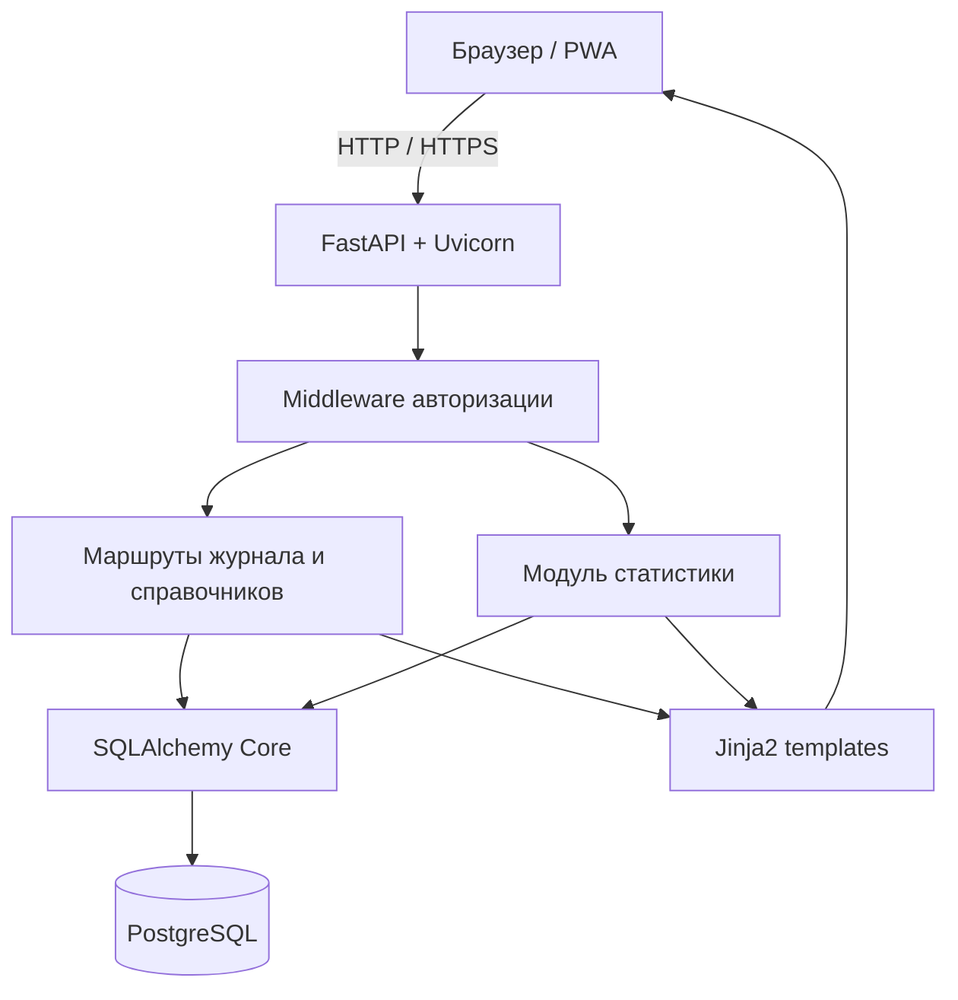
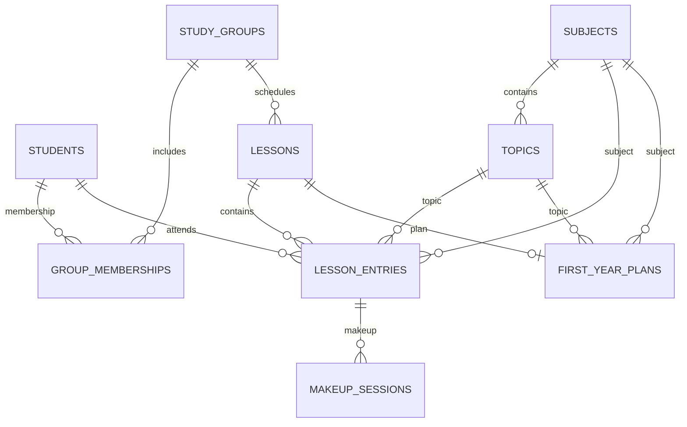
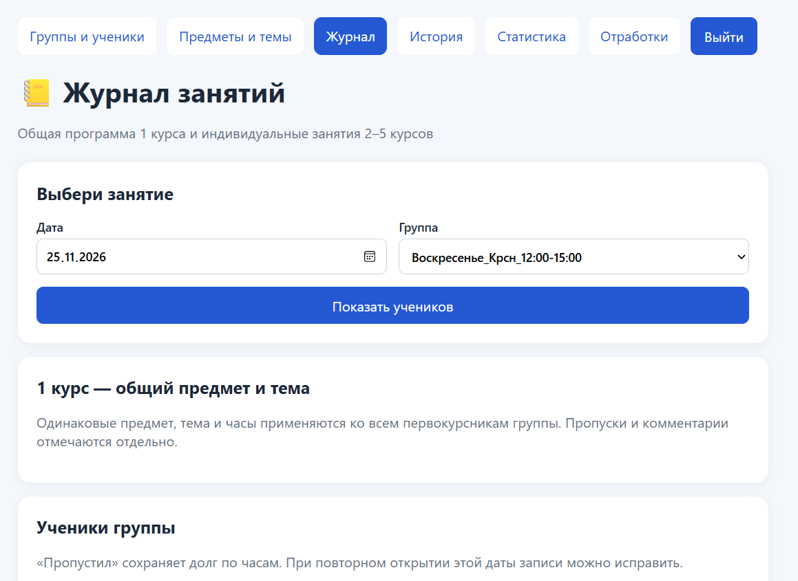
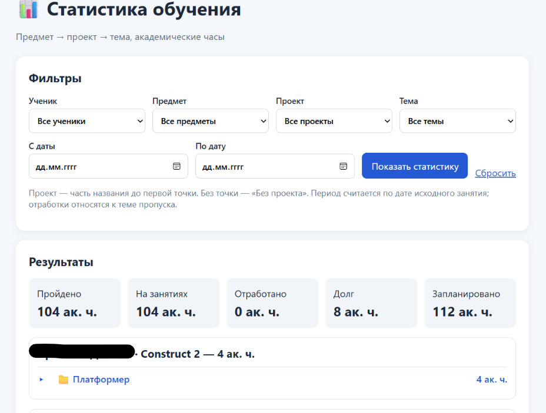
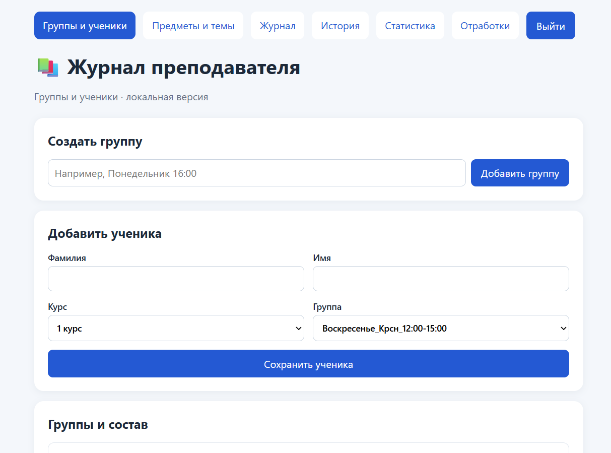
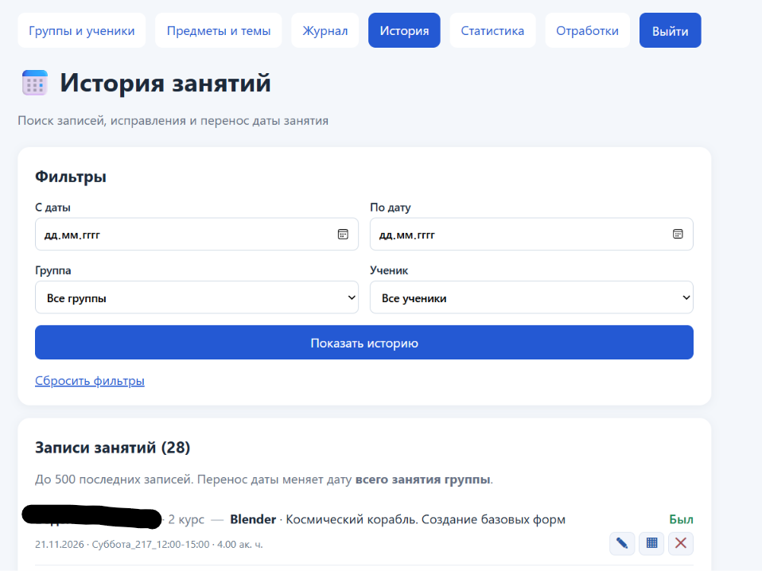
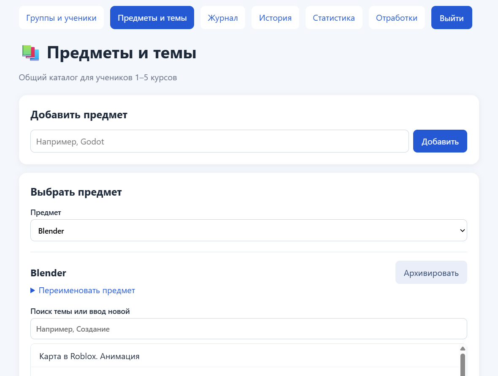
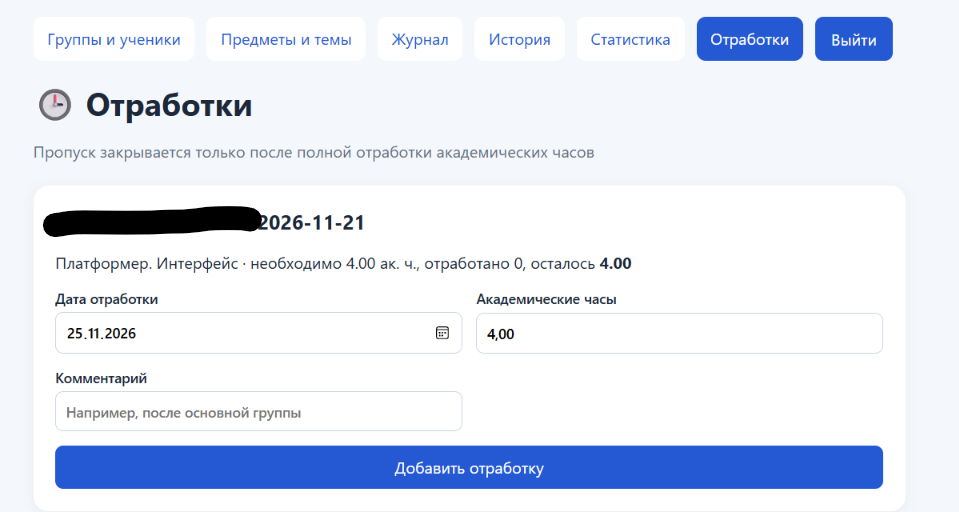
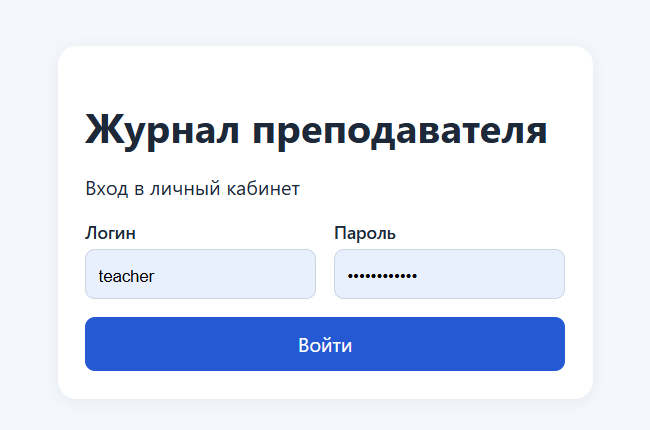

# TeacherJournal

**Развёрнутое приложение:** [TeacherJournal](https://teacherjournal.onrender.com/login) (требуется авторизация).

Веб-приложение для автоматизации работы преподавателя: ведения электронного журнала, учёта посещаемости, академических часов и отработок, управления учебными группами и анализа успеваемости по объёму пройденного материала.

Проект ориентирован на практические задачи дополнительного образования. Интерфейс доступен в браузере и поддерживает установку в качестве PWA.

## Возможности

- **Ученики и группы:** добавление и редактирование учеников, изменение курса, управление принадлежностью к группам и активностью.
- **Каталог:** создание, переименование и архивирование предметов и тем.
- **Журнал:** выбор группы и даты, общая программа для первого курса и индивидуальные темы для остальных курсов, посещаемость, часы и комментарии.
- **Отработки:** регистрация отработанных часов по пропущенным занятиям и просмотр оставшихся часов.
- **История:** фильтрация по датам, группам и ученикам, редактирование записей и перенос даты занятия всей группы.
- **Статистика:** плановые, посещённые, отработанные и оставшиеся часы; детализация по ученикам, предметам, проектам и темам.
- **Авторизация:** вход преподавателя, защищённые сессии и выход из системы.

## Технологический стек

| Уровень | Технологии |
| --- | --- |
| Backend | Python, FastAPI, Uvicorn |
| Database | PostgreSQL |
| Data access | SQLAlchemy Core, psycopg2, параметризованный SQL |
| Frontend | Jinja2, HTML, CSS, JavaScript |
| PWA | Web App Manifest, Service Worker |
| Configuration | python-dotenv, переменные окружения |
| Deployment | Render Blueprint (`render.yaml`) |

## Архитектура

Приложение построено как серверный монолит с HTML-шаблонами и отдельными модулями авторизации и статистики.



### Backend и целостность данных

- Транзакции при сохранении занятий и связанных записей.
- Параметризованные SQL-запросы и проверка соединений через `pool_pre_ping`.
- PostgreSQL advisory transaction lock для сериализации сохранений занятия одной группы на одну дату.
- Блокировки строк `FOR UPDATE` при изменении отдельных записей.
- Проверки принадлежности ученика группе, соответствия темы предмету и допустимости академических часов.
- Защита от удаления записей с отработками и изменения часов ниже уже отработанного объёма.
- SQL-агрегации, `JOIN`, `LEFT JOIN LATERAL` и `GROUP BY` для формирования статистики.

## Модель данных

Основные сущности, используемые SQL-запросами приложения (логическая схема, без полного описания ограничений БД):



## Безопасность

- Пароль хранится в виде PBKDF2-HMAC-SHA256 хеша с индивидуальной солью и 600 000 итераций.
- Случайные сессионные токены с TTL 12 часов; cookie с `HttpOnly`, `SameSite=Strict` и `Secure` при HTTPS.
- Ограничение частоты попыток входа и проверка заголовка `Origin` для изменяющих запросов.
- Заголовки безопасности и запрет кеширования ответов приложения.
- Секреты и параметры подключения вынесены в переменные окружения.

Текущая модель рассчитана на одного преподавателя. Сессии и счётчик попыток входа хранятся в памяти процесса; перезапуск сервера завершает активные сессии. Для горизонтального масштабирования потребуется общее хранилище сессий.


## Интерфейс

| Журнал | Статистика |
| --- | --- |
|  |  |
| Ученики и группы | История занятий |
|  |  |
| Каталог | Отработки |
|  |  |

### Авторизация



Основные страницы: ученики и группы, журнал занятий, каталог предметов и тем, история, отработки и статистика.

## Структура проекта

```text
TeacherJournal/
├── main.py                 # Маршруты, бизнес-логика, подключение к БД
├── auth.py                 # Middleware и сессионная авторизация
├── setup_auth.py           # Генерация хеша пароля
├── statistics_routes.py    # Маршруты и расчёт статистики
├── templates/              # HTML-шаблоны Jinja2
├── static/                 # CSS, PWA, иконки
├── requirements.txt        # Зависимости Python
├── render.yaml             # Конфигурация развёртывания
├── .gitignore
└── README.md
```

